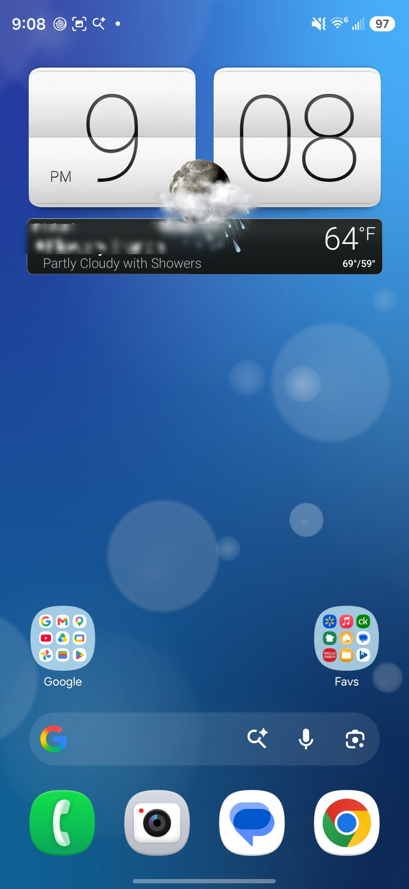

# HTC Sense Weather Flip Clock (Android)

Home-screen **4×2 flip clock** widget in the classic **HTC Sense** style, rebuilt for **modern Android**. Weather uses **Open-Meteo** (no AccuWeather or HTC weather account required).

> **Not affiliated with HTC.** Community port for phones where the original widget no longer works correctly.

## Screenshots

| Home screen | Flip animation |
|-------------|----------------|
|  | [Watch flip demo (MP4)](./screenshots/flip-animation.mp4) |

Location name is blurred for privacy in these media files.

## What was broken (original APK / old port)

On **recent Android versions** (including current **Android 15 / 16**–class builds on devices like Samsung S24/S25/S26 Ultra), the classic **HTC Weather Clock** often:

- **Weather blank or stuck** — legacy **AccuWeather / HTC weather** backends are gone or blocked; the strip never updates.
- **Time stops updating** — digits freeze on old minutes or hours until you force-remove the widget.
- **No flip animation** — digits swap instantly or not at all; the Sense flip effect is lost.
- **Widget crashes or fails to load** — older builds target outdated APIs and break under stricter background and network rules.

Installing the old Play/APKMirror package alone does **not** fix this on a current phone.

## What this APK fixes (what works now)

This release (**`HTC-WeatherClock-10.10.1059527-android36.apk`**) is built for **today’s Android**:

| Area | Status |
|------|--------|
| **Latest Android compatibility** | **minSdk 24**, **targetSdk 36** — intended for current flagship / stock Android versions, not just old ROMs. |
| **Weather** | **Works** via **Open-Meteo** (current conditions + forecast data wired into the widget). |
| **Flip clock** | **Flip animation runs** — Sense-style digit flips on time changes. |
| **Time updates** | **Clock keeps time** — updates with system time / refresh paths; **does not stay stuck** like the broken legacy behavior. |
| **Location / sync** | Bridge layer replaces dead HTC sync with a local weather provider and modern refresh behavior. |
| **Manual city** | Choose a city in widget settings (list or search/add); selection is persisted for the widget. |
| **Temperature unit** | Switch **°F** and **°C** in settings; the widget follows your choice. |

Exact layout may vary slightly by launcher and screen size; core clock, flip, and weather strip are what this port restores.

## Widget settings (manual city & °F / °C)

1. Add the **4×2 Weather Clock** widget, then open its **settings** (tap the widget or use the widget’s configure action).
2. **City**
   - Tap **Current location** to use GPS weather and local time for where you are.
   - Or tap any city in the list (e.g. cities you added earlier).
   - Use **+** / search to find and add a city (e.g. Los Angeles, San Diego), then tap it to select.
3. **Temperature**
   - Use the **°F / °C** control in settings. The widget should refresh with the unit you picked.

If a city does not stick after you leave settings, install the **latest release** from GitHub (Oct 2026 build includes persistence and refresh fixes). Uninstall older sideloads of the same app if install or behavior is inconsistent.

## Download

Get the latest APK from **[Releases](https://github.com/neptaligonzalez7-afk/htc-weather-flip-clock/releases)**.

| Release | File | Notes |
|---------|------|--------|
| **Latest (Oct 2026)** | `HTC-WeatherClock-10.10.1059527-android36.apk` | Manual city + °F/°C settings |
| First release | Same filename on tag `v1.0.0` | Flip clock + Open-Meteo baseline |

**versionCode:** `663091309` · **targetSdk 36**

## Requirements

- Android **7.0+** (API 24) through **current Android** (this build targets **API 36**)
- Internet for weather sync
- Location permission optional (for automatic local weather)

## Install

1. Download the latest release APK from **Releases**.
2. On the phone: allow **Install unknown apps** for your browser or Files app.
3. Open the APK and install.
4. If install fails with **“App not installed”** or **signature conflict**:
   - Uninstall any existing **`com.htc.widget.weatherclock`** app (Play, OEM, or older APK), then retry.
   - *(This removes the widget from home screens; add it again after install.)*

Developers: `adb install -r HTC-WeatherClock-10.10.1059527-android36.apk`

## Add the widget

1. Long-press home screen → **Widgets**.
2. Find **Weather Clock** (HTC) → **4×2**.
3. Place on home screen, then open **settings** to pick **city** and **°F or °C**.

## Signing

APKs are **debug-signed** for sideloading. They are not Play Store builds. Do not install over a differently signed build of the same package without uninstalling first.

## License

See [LICENSE](./LICENSE). HTC Sense names and assets are trademarks of their respective owners.

## Reporting issues

Open a **GitHub Issue** with device model, **Android version**, launcher name, and screenshots or a short screen recording.
